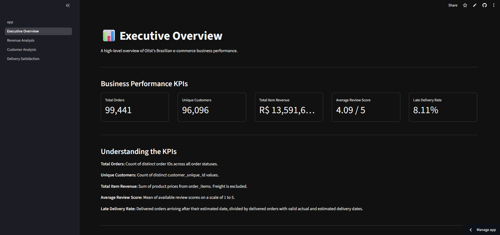
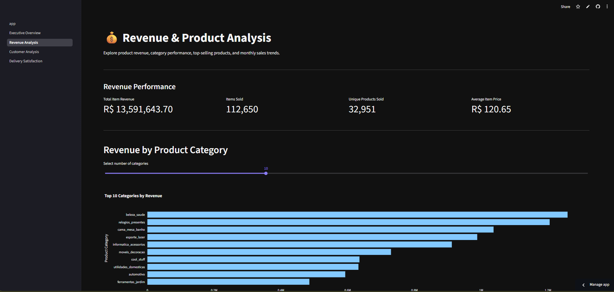
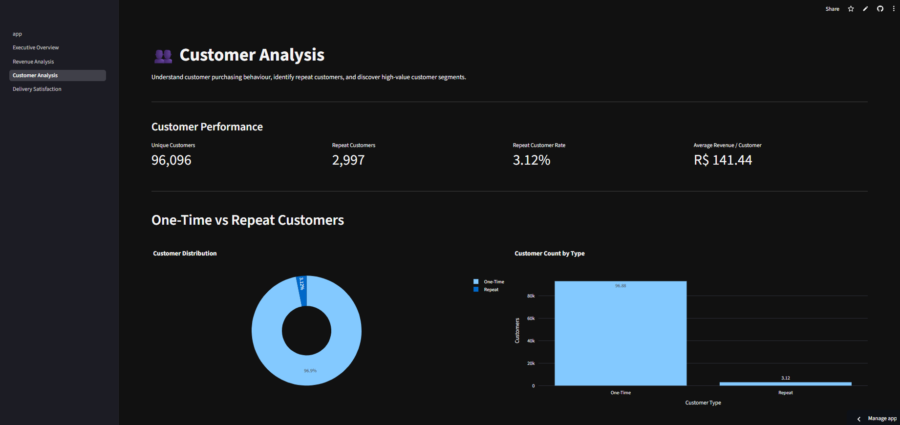
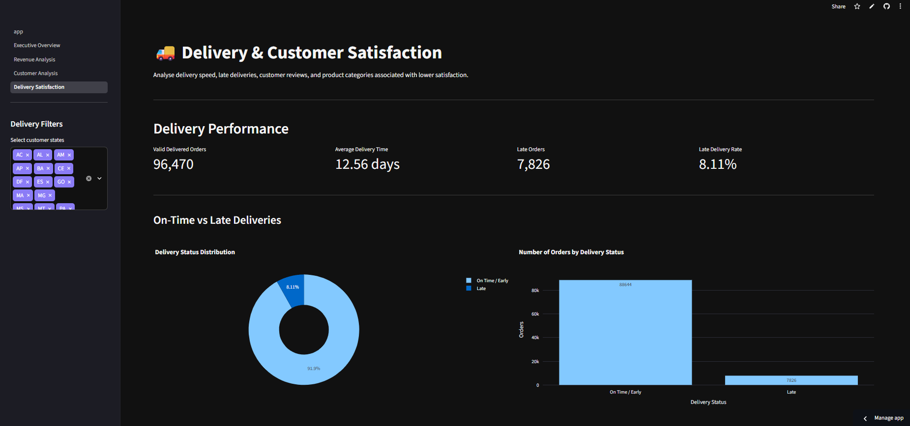

# Olist Brazilian E-Commerce Data Analytics

An end-to-end data analytics project exploring Brazilian e-commerce transactions to understand revenue performance, customer behavior, product trends, delivery operations, and customer satisfaction.

**Live Dashboard:** [Explore the Streamlit App](https://olist-ecommerce-analysis-fw7rfhkmprfrzfpqrg5bkh.streamlit.app/)

**Tech Stack:** Python · SQL · PostgreSQL · Pandas · NumPy · Matplotlib · Seaborn · Plotly · Streamlit · Git · GitHub

---

## 1. Project Overview

This project analyzes the Olist Brazilian E-Commerce dataset to answer three important business questions:

1. Where is revenue coming from?
2. Which customers are most valuable?
3. What is hurting customer satisfaction?

The project follows an end-to-end analytics workflow, starting with SQL-based data exploration and cleaning, followed by business analysis, Python-based exploratory data analysis, and an interactive Streamlit dashboard.

## 2. Business Objectives

- Analyze overall e-commerce sales and revenue performance.
- Identify top-performing product categories and products.
- Understand customer purchasing and repeat-purchase behavior.
- Perform RFM-based customer segmentation.
- Evaluate delivery performance and delays.
- Analyze customer reviews and satisfaction.
- Convert analytical findings into actionable business insights.

## 3. Dataset

The project uses the Olist Brazilian E-Commerce Public Dataset.

The dataset contains information about:
- Customers
- Orders
- Order items
- Payments
- Products
- Sellers
- Reviews
- Geolocation
- Product category translations

**Core dataset size:**

| Dataset | Records |
|---|---:|
| Customers | 99,441 |
| Orders | 99,441 |
| Order Items | 112,650 |
| Payments | 103,886 |
| Reviews | 99,224 |
| Products | 32,951 |
| Sellers | 3,095 |

## 4. Tools & Technologies

| Technology | Purpose |
|---|---|
| Python | Data analysis and processing |
| SQL | Data querying and business analysis |
| PostgreSQL | Relational database management |
| Pandas | Data cleaning and manipulation |
| NumPy | Numerical operations |
| Matplotlib & Seaborn | Exploratory data visualization |
| Plotly | Interactive charts |
| Streamlit | Interactive analytics application |
| Git & GitHub | Version control and project hosting |

## 5. Project Workflow

### Phase 1: SQL Setup and Data Loading
- Created a PostgreSQL database.
- Loaded the raw Olist datasets.
- Explored tables, columns, and relationships.

### Phase 2: Data Cleaning
- Checked missing values and duplicates.
- Validated primary and composite keys.
- Investigated inconsistent and incomplete records.
- Prepared datasets for analysis.

### Phase 3: Exploratory Data Analysis
- Analyzed sales and order distributions.
- Explored product categories and customer behavior.
- Examined delivery performance and review patterns.
- Identified trends and outliers.

### Phase 4: SQL Business Analysis
- Used joins, aggregations, CTEs, and window functions.
- Analyzed revenue, customers, products, and sellers.
- Developed queries to answer business questions.

### Phase 5: Delivery and Customer Satisfaction
- Calculated delivery durations and late delivery rates.
- Compared review scores for late and on-time deliveries.
- Examined customer satisfaction across categories and locations.

### Phase 6: Interactive Streamlit Application
- Developed a multi-page analytics application.
- Created KPI cards and interactive visualizations.
- Organized business insights into dedicated dashboard pages.
- Deployed the application using Streamlit Community Cloud.

## 6. Key Business Insights

The following findings were identified from the analyzed dataset:

| Metric | Result |
|---|---:|
| Total Orders | 99,441 |
| Unique Customers | 96,096 |
| Order Items | 112,650 |
| Item Revenue | R$13.59M |
| Freight Revenue | R$2.25M |
| Average Review Score | 4.09 / 5 |
| Repeat Customers | 2,997 |
| Late Delivery Rate | 8.11% |

### Revenue Insights
- Total item revenue was approximately R$13.59 million, excluding freight.
- `beleza_saude` was the highest-revenue product category.
- November 2017 recorded the highest monthly revenue in the analyzed data.
- São Paulo generated the highest revenue among Brazilian states.

### Customer Insights
- Only approximately 3.12% of unique customers made repeat purchases.
- Repeat customers generated higher average revenue per customer than one-time customers.
- RFM segmentation was used to understand customer value and purchasing behavior.

### Delivery and Satisfaction Insights
- Approximately 8.11% of valid delivered orders were delivered late.
- Average delivery time was approximately 12.56 days.
- Late deliveries had an average review score of 2.57.
- On-time or early deliveries had an average review score of 4.29.

**Business interpretation:** Delivery delays are strongly associated with lower customer review scores in this dataset. This is an observed relationship, not proof of causation.

## 7. Streamlit Dashboard

The application contains four analytical pages.

| Page | Features |
|---|---|
| Executive Overview | Business KPIs and overall performance |
| Revenue Analysis | Category revenue, top products, monthly trends |
| Customer Analysis | Repeat customers, RFM segmentation, top customers |
| Delivery & Satisfaction | Delivery performance, state analysis, customer reviews |

**Access the live application:**

[Olist E-Commerce Analytics Dashboard](https://olist-ecommerce-analysis-fw7rfhkmprfrzfpqrg5bkh.streamlit.app/)

## 8. Dashboard Screenshots

### Executive Overview


### Revenue Analysis


### Customer Analysis


### Delivery & Satisfaction


## 9. Project Structure

```text
olist-ecommerce-analysis/
│
├── app.py
├── requirements.txt
├── README.md
├── .gitignore
│
├── .streamlit/
│   └── config.toml
│
├── pages/
│   ├── 1_Executive_Overview.py
│   ├── 2_Revenue_Analysis.py
│   ├── 3_Customer_Analysis.py
│   └── 4_Delivery_Satisfaction.py
│
├── data/
│   ├── raw/
│   └── processed/
│
├── notebooks/
├── scripts/
├── reports/
└── sql/
```

## 10. Run Locally

### Step 1: Clone the repository

```bash
git clone https://github.com/shubham17-web/olist-ecommerce-analysis
```

```bash
cd olist-ecommerce-analysis
```

### Step 2: Create a virtual environment

```bash
python -m venv .venv
```

Activate it on Windows:

```bash
.venv\Scripts\activate
```

### Step 3: Install dependencies

```bash
pip install -r requirements.txt
```

### Step 4: Run the Streamlit application

```bash
streamlit run app.py
```

The application will open in your browser.

**Note:** The application requires the processed CSV files in `data/processed/`. Raw datasets are excluded from the repository. The deployed application uses the files available in the repository.

## 11. Key Learning Outcomes

Through this project, I gained practical experience in:

- Working with real-world relational datasets.
- Writing SQL queries for business analysis.
- Data cleaning and validation using Python.
- Exploratory data analysis and visualization.
- Customer segmentation using RFM analysis.
- Analyzing delivery operations and customer satisfaction.
- Building multi-page interactive applications using Streamlit.
- Managing projects with Git and GitHub.
- Deploying a data analytics application to the cloud.

## 12. Future Improvements

- Add more advanced customer lifetime value analysis.
- Improve customer retention analysis.
- Explore predictive models for delivery delays.
- Add more interactive business filters and drill-downs.
- Expand the analysis with additional operational metrics.

---

**Project Type:** End-to-End Data Analytics

**Status:** Completed and Deployed

**Live Application:** https://olist-ecommerce-analysis-fw7rfhkmprfrzfpqrg5bkh.streamlit.app/

**Author:** Pranab Singh